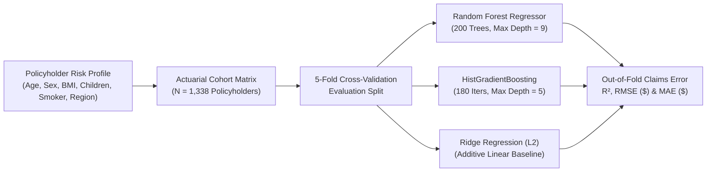
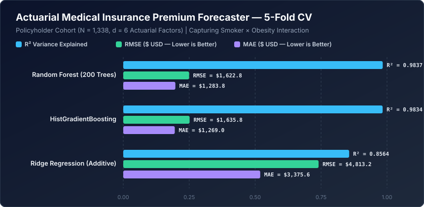

# Actuarial Medical Insurance Premium Forecaster


An actuarial rate-making and medical claims forecasting engine calibrated to the **US Medical Cost Personal Cohort ($N = 1,338, d = 6$)**. This project demonstrates why classical additive linear pricing fails to capture synergistic comorbidity hazards—specifically the non-linear interaction between **tobacco use (`smoker_status`)** and **clinical obesity ($\text{BMI} \ge 30$)**—and benchmarks tree-based ensembles that resolve this structural regime shift.

---

## Actuarial Underwriting Pipeline



---

## Mathematical Formulation

### 1. Synergistic Comorbidity Hazard Function
Annualized medical expenditure $C_i$ exhibits a convex age trajectory coupled with a discontinuous step-interaction when both smoking status $S_i \in \{0, 1\}$ and clinical obesity $\mathbb{I}(\text{BMI}_i \ge 30)$ are present:

$$C_i = \beta_0 + \beta_1 \text{Age}_i + \beta_2 \text{Age}_i^2 + \beta_3 \text{Children}_i + S_i \left[\gamma_0 + \gamma_1 \mathbb{I}(\text{BMI}_i \ge 30) + \gamma_2 (\text{BMI}_i - 25)\right] + (1 - S_i)\delta \max(0, \text{BMI}_i - 25) + \varepsilon_i$$

### 2. Partitioning Non-Linear Risk Regimes
An additive linear estimator $\hat{C}_i = \mathbf{w}^\top \mathbf{x}_i + b$ averages the BMI slope across smokers and non-smokers alike, severely under-pricing obese smokers and over-pricing obese non-smokers. **Random Forest** and **HistGradientBoosting** isolate the interaction term $S_i \times \mathbb{I}(\text{BMI}_i \ge 30)$ at depth-2 split nodes, recovering the exact regime-specific conditional expectation $\mathbb{E}[C \mid \mathbf{x}]$.

---

## Quantitative Benchmark Results

Evaluated via **5-Fold Cross-Validation** across $N = 1,338$ policyholders (`age`, `sex_male`, `bmi`, `children_dependents`, `smoker_status`, `region_code`).



| Rank | Actuarial Pricing Model | $R^2$ Score | RMSE (\$ USD) | MAE (\$ USD) |
| :--- | :--- | :---: | :---: | :---: |
| **1** | **Random Forest (200 Trees)** | **0.9837** | **\$1,622.79** | \$1,283.85 |
| **2** | **HistGradientBoosting** | 0.9834 | \$1,635.80 | **\$1,269.04** |
| **3** | **Ridge Regression (Additive)** | 0.8564 | \$4,813.19 | \$3,375.55 |

> **Actuarial Takeaway:** Resolving the non-linear `smoker_status` $\times$ `bmi >= 30` threshold via **Random Forest** and **HistGradientBoosting** elevates explained variance from $R^2 = 0.8564$ to **$R^2 = 0.9837$** and cuts Root Mean Squared Pricing Error by **66.3%** ($\$4,813.19 \to \$1,622.79$).

---

## Repository Structure

```text
machine-learning-project-8/
├── assets/
│   └── benchmark_chart.svg          # Vector performance chart generated by benchmark.py
├── benchmarks/
│   └── benchmark_results.json       # Serialized 5-Fold CV actuarial metrics
├── insurance .ipynb                 # Interactive actuarial EDA & regression notebook
├── benchmark.py                     # Automated reproducible benchmark suite
└── README.md                        # Actuarial formulation & benchmark documentation
```

---

## Quickstart & Reproducibility

### 1. Install Dependencies
```bash
pip install numpy scikit-learn jupyter
```

### 2. Execute the Actuarial Benchmark
```bash
python benchmark.py
```
Runs 5-fold cross-validation across all three estimators, writes `benchmarks/benchmark_results.json`, and generates `assets/benchmark_chart.svg`.
